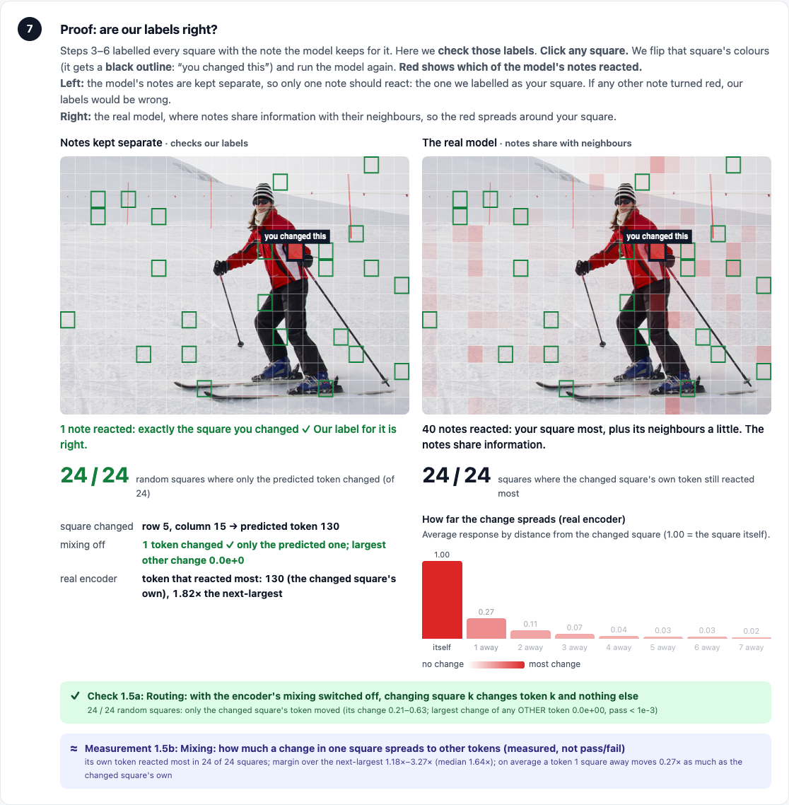

# VisRetain

**Does rounding a vision-language model's memory change what it forgets?**

Capstone project PW26_KT_03 · B.Tech CSE (AI & ML), PES University · Guide: Kriti Taneja
Team: Ashwin C H, Dhanush Shankar Reddy, Pallavi B, Akash Ramesh

When a vision-language model (VLM) answers a question about an image, it cuts the image into
patches, keeps one "note" per patch in its memory (the **KV cache**), and re-reads those notes for
every word it writes. Real deployments save memory in two ways at once: they **round** the notes
to fewer bits (quantization) and they **throw away** the least-looked-at notes (eviction). Some
parts of an image look unimportant early in an answer but are needed later (**deferred
importance**). This project measures whether rounding makes the model throw that evidence away
too early.

VisRetain is a **measurement instrument**, not a new model. It runs
[Qwen2.5-VL-3B-Instruct](https://huggingface.co/Qwen/Qwen2.5-VL-3B-Instruct) locally, hooks into
its attention and KV cache, and is built and **verified one stage at a time**.



---

## Status

The instrument follows the model's own flow. Each stage is researched, its pass criteria are
written down **before** its checks are built, then it is verified on the real model across 13
images (10 photos plus a huge photo, a tiny image and an 8:1 panorama). Full log: [`STAGES.md`](STAGES.md).

| Stage | What | Status |
|---|---|---|
| 1 | Image → visual tokens: which square of the image each cached token stands for | **Verified** — 8/8 checks on 13/13 images ([report](STAGE1_REPORT.md)) |
| 2 | Attention: the attention we compute is exactly the model's own | **Verified** — 6/6 checks on 13/13 images ([report](STAGE2_REPORT.md)) |
| 3 | Rounding the cache (FP16 / INT4 / INT2) | Next |
| 4 | Eviction at full precision | Next |
| 5 | Eviction with rounding | Next |
| 6 | Evidence: what the answer actually needs (GQA object boxes) | Later |
| 7 | Metrics and statistics | Later |

**Before committing further, a kill test** decides go / pivot / stop under realistic conditions:
the model describes a photo with limited, rounded memory, *then* is asked a GQA question about a
detail, scored against the human answer. See [`PLAN.md`](PLAN.md).

An exploratory full pipeline (the `/full` demo) ran ahead of this verification. Its early numbers:
rounding changes 8.8% (INT4) and 33.5% (INT2) of what gets evicted, yet does **not** make
late-needed evidence get lost more often — about 80% of it is lost even at full precision
([`FINDINGS.md`](FINDINGS.md)). Treat these as preliminary until stages 3–7 are verified.

---

## Setup

**Hardware.** An Apple-silicon Mac with 16 GB (what this was verified on) or an NVIDIA GPU with
≥ 16 GB. The CUDA path is supported in code but has not been tested yet. About 10 GB of free disk
(the model is ~7 GB).

```bash
git clone https://github.com/dhanush-sr/visretain.git
cd visretain
python3 -m venv .venv && source .venv/bin/activate
pip install -r requirements.txt

# optional, for the browser tests
playwright install chrome     # or skip: the tests use an installed Google Chrome if present
```

The first run downloads the model from Hugging Face (open-source, Apache 2.0; no API key) and the
pilot photos from COCO. Everything runs **locally and offline** afterwards.

---

## Run it

### The visual demo

```bash
./demo.sh            # live app → http://localhost:8765 (loads the model once, ~20–60 s)
./demo.sh static     # offline pages, no model needed (demo/stages.html, demo/visretain_demo.html)
```

In the live app:

- **`/` — the stages page.** Drop in any image (or click a sample).
  - *Stage 1 tab:* how Qwen resizes the image, cuts it into 14 px patches and 28 px tokens, where
    they sit in the prompt, and the proof: change one square and see which token reacts — with the
    encoder's mixing switched off (exactly one token changes: the predicted one) and on (the change
    spreads to neighbours).
  - *Stage 2 tab:* type a question; the model answers. Click any word to see which patches it
    looked at while choosing that word; click a patch to see its attention word by word; slide
    through the 36 layers.
- **`/full` — the full pipeline** (exploratory): watch FP16 / INT4 / INT2 copies of the memory
  evict patches live while the model answers, and whether late-needed evidence survived.

> Memory tip: on a 16 GB Mac, close Docker and other heavy apps first. Only one model process can
> run at a time; `demo.sh` refuses to start a second.

### Verification

Each needs the GPU free (stop the app first).

| Command | What it checks | Time |
|---|---|---|
| `python3 visretain.py` | self-check of the quantizer and metrics (no model) | seconds |
| `python3 test_stage1.py` | stage 1, all checks on 13 images → `STAGE1_REPORT.md` | ~30 min |
| `python3 test_stage2.py` | stage 2, all checks + negative controls on 13 images → `STAGE2_REPORT.md` | ~8 min |
| `python3 test_pipeline.py` | non-interference, determinism, live = batch, size cap, server edge cases → `TEST_REPORT.md` | ~5 min |
| `python3 test_browser.py` | the live app in a real browser (needs `python3 app.py` running) | ~3 min |

### Experiments and builds

| Command | What it does |
|---|---|
| `python3 run_timeline.py --items 8` | full-pipeline batch on the pilot photos → `results_timeline/` |
| `python3 run_timeline.py --image photo.jpg --question "…"` | the same on your own image |
| `python3 build_demo.py` | rebuild the offline full-pipeline page |
| `python3 build_stages.py` | rebuild the offline stages page (~25 min: precomputes every square) |
| `python3 run_kill_test.py` | earlier ranking-only experiment (shadow ranking), kept for the record |
| `python3 analyze_acc.py results_acc` | statistics for that experiment |

---

## How it works

- **Hooks, not a fork.** A custom attention function is registered with Hugging Face
  Transformers for the *language model* only. It hands the real computation to the normal fast
  attention (SDPA) untouched and records the post-rotary queries and keys on the side. Tests prove
  the model's answer is token-for-token unchanged.
- **One config.** Every setting lives in [`config.json`](config.json) (memory budget, bit widths,
  layers, image budget, evidence windows, sample photos, …). Every result file stores the settings
  that produced it.
- **Counterfactual eviction (full pipeline).** Each precision keeps its own evicted set while the
  model answers from the full cache, so all arms see identical inputs. It shows what *would* be
  lost; the kill test adds real eviction to measure answer accuracy.

## Repository layout

```
config.json          every setting
cfg.py               loads config.json
visretain.py         quantizers, scoring, rank-agreement metrics (+ self-check)
run_timeline.py      model loading, attention hook, counterfactual eviction, run records
stages.py            stage 1 and stage 2 verification (data + checks)
stages_page.py       the stages page (HTML/JS)
app.py               local web server: stages page, full pipeline, live runs
build_demo.py        full-pipeline page builder
build_stages.py      offline stages page builder
demo.sh              launcher
test_*.py            verification suites
STAGES.md            stage-by-stage research, decisions, pass criteria, results
PLAN.md              plan and open decisions
FINDINGS.md          exploratory findings (before stage-by-stage verification)
*_REPORT*.md         test reports (STAGE1_REPORT_v1.md = the first, failed version of check 1.5)
results_*/           result records (JSON) backing the reports and pages
demo/                offline pages and screenshots
docs/CONTEXT.md      project context for new contributors
```

## Known limitations and open decisions

- Verified on one model (Qwen2.5-VL-3B) on Apple silicon; a second, larger model is planned.
- Quantization is simulated (values rounded, memory not physically shrunk) — standard practice for
  accuracy studies (KIVI, QEvict, CVMA).
- **Open:** Qwen's vision encoder runs close to fp16's numeric limit (an overflow was found on an
  extreme panorama, now guarded by check 1.8). Switching the vision encoder to bfloat16 would be
  more robust but changes the instrument; undecided.
- **Scope:** retrieval (RAG) strategies are out of scope for now.

## Data and licences

- Model: Qwen2.5-VL-3B-Instruct, Apache 2.0, downloaded from Hugging Face at first run.
- Pilot images: COCO val2017 (downloaded at first run; the images remain under their original
  licences). The offline demo pages and screenshots contain resized copies of a few of them.
- GQA (planned for the kill test): CC BY 4.0 annotations.
